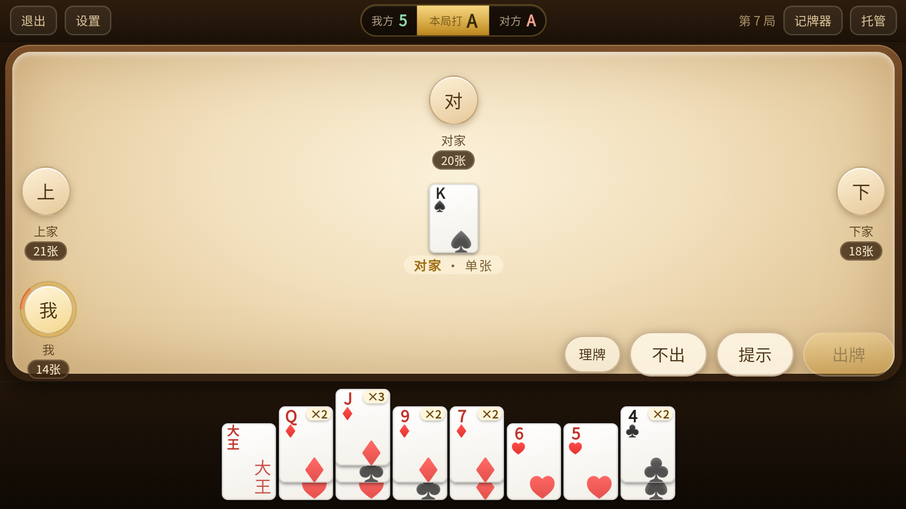
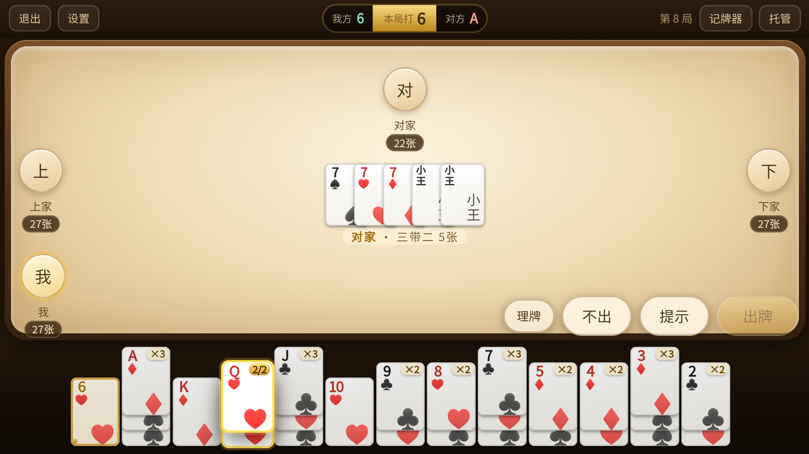
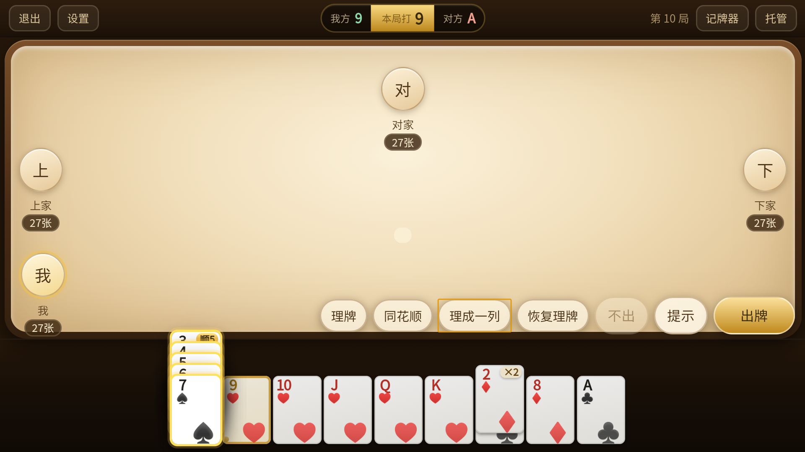
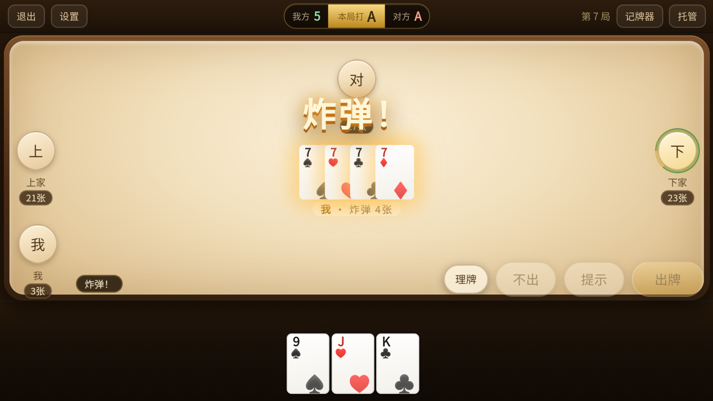
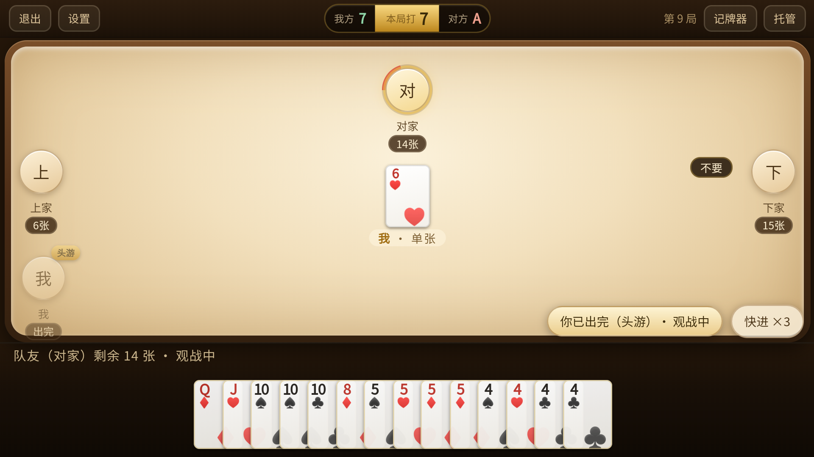
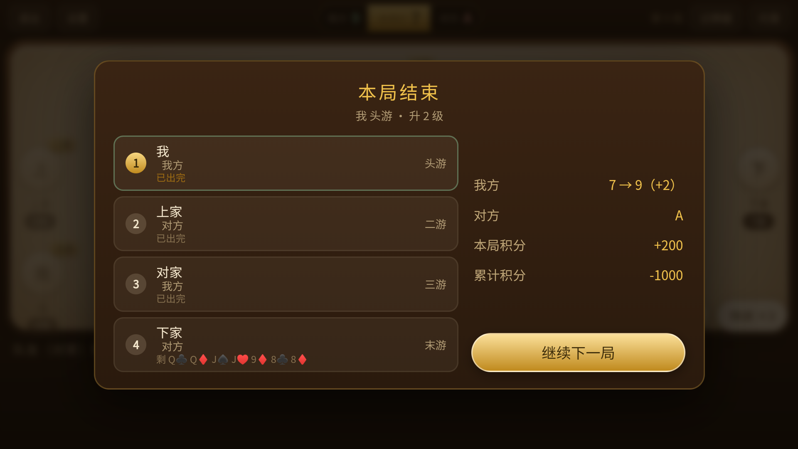
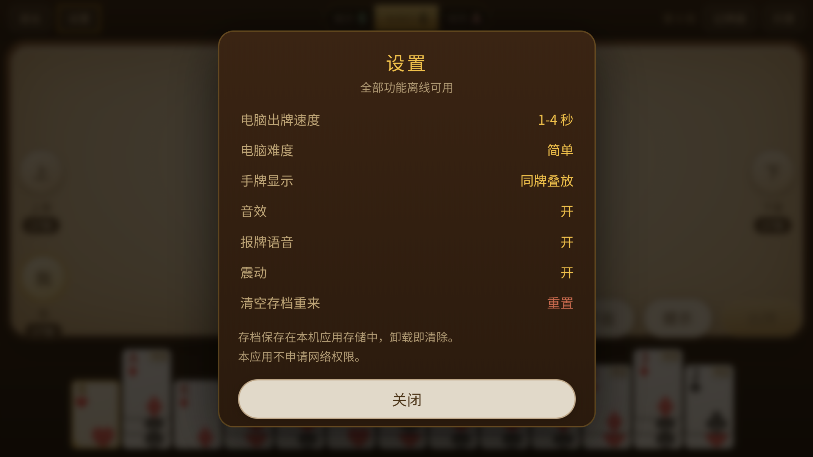

# 掼蛋单机版 · Guandan Single Player

一个**完全离线**的掼蛋（Guandan）单机版：纯前端实现 + 原生 Android WebView 外壳，可当网页跑，也可直接装 APK 玩。本仓库是最终优化版，**源码与安装包一起开源**。

* 零网络：APK **不申请 INTERNET 权限**，全部逻辑、语音、存档都在本机
* 零外部素材：牌面、牌桌、按钮全部 CSS 绘制，音效由 WebAudio 实时合成，报牌语音是随包分发的 mp3
* 双人对家 AI：会送牌、会堵门，也有三档难度
* 手机上强制横屏，手牌按点数叠成一摞，支持一键理同花顺



## 下载安装（现成 APK）

| | |
|---|---|
| 版本 | **v1.0 · 最终优化版** |
| 安装包 | [`dist/GuandanSingle-v1.0.apk`](dist/GuandanSingle-v1.0.apk)（282 KB） |
| 备用下载 | [GitHub Releases 最新版](https://github.com/n44897162-eng/guandan-single-player/releases/latest) |
| 适用 | Android 5.0+，横屏，手机 / 平板 |

下载 APK → 在系统提示里允许「安装未知来源应用」→ 安装完成后打开即可。不用联网、不用登录、不用授权（APK 只申请震动权限）。

安装包与仓库内 `index.html / app.css / app.js / game/ / voice/` 是同一份代码，SHA-256：

`256f3b516acef3aa88a7f5c885e57e4cc034596ee0f014eda1fec8ca637bbe15`

> 签名用的是打包脚本生成的调试证书，仅用于个人安装与学习；正式分发请自行生成 keystore。

## 功能

**对局**
- 完整掼蛋规则：级牌、逢人配（红桃级牌）、炸弹层级（4~10 张 / 同花顺 / 天王炸）、顺子 / 三连对 / 钢板 / 三带二
- 进贡 / 还贡 / 抗贡：大于 10 的牌和逢人配不能还贡，双大王可抗贡
- 接风：出完牌三家都不要，搭档接风先出
- 升级：头游 + 二游（双下）升 3 级、头游 + 三游升 2 级、头游 + 末游升 1 级；附积分
- 一局一存档，退出/杀进程后回来接着打

**操作**
- 手牌按**点数**叠成一摞（两副牌同点最多 8 张），右上角标 `×N`
- 短按一摞 = 选一张（连点连选），长按 400ms = 扇开挑具体花色
- 选中牌金色描边 + 上浮，未选牌自动压暗，配短震动和点击音
- 「提示」直接按策略选中一手（多出牌、不拆炸弹、不浪费逢人配、能一手走完优先），再点换下一手
- 「同花顺」→「理成一列」→「恢复理牌」：一键找出同花顺、并成一摞竖叠（每张露出点数）、再拆回原样；连点「同花顺」可以切换不同的同花顺
- 真人玩家无限时间出牌，没有倒计时、没有超时语音；电脑思考 5~8 秒

**观战**
- 自己出完牌后进入观战：手牌区换成**队友的手牌**（正面朝上），可以看队友和电脑继续打完
- 结算时能看到队友具体剩牌；观战可「快进 ×3」，把电脑思考时间压到 1/4

**表现**
- 炸弹 / 同花顺 / 天王炸：大字横幅 + 闪光 + 震屏 + 出牌区金色脉冲 + 分级震动
- 报牌语音：单张 / 对子 / 三张 / 三带二 / 顺子 / 三连对 / 钢板 / 炸弹 / 同花顺 / 天王炸 / 不要 / 报单 / 报双 / 接风 / 头游 / 末游
- 发牌淡入、出牌逐张飞入、按钮按压缩放

## 截图

| 选牌 | 同花顺理成一列 |
|---|---|
|  |  |

| 炸弹特效 | 观战队友 |
|---|---|
|  |  |

| 结算（显示剩余牌） | 设置 |
|---|---|
|  |  |

## 快速开始

### 当网页玩

直接用浏览器打开 `index.html` 即可（`file://` 也能跑，语音需要浏览器允许自动播放）。

```bash
# 或者起个静态服务器
python -m http.server 8080
# 打开 http://localhost:8080
```

### 打包 APK

仓库已经附带编译签名好的安装包 `dist/GuandanSingle-v1.0.apk`，下面步骤只在你想自己重新打包时需要。

需要 Android SDK（build-tools 34.x / 36.x 均可）、JDK 8+、Python 3。

```bash
export ANDROID_SDK=$HOME/Android/Sdk      # 改成你的 SDK 路径
cd android
bash build_apk.sh
# 产物：build/apk/GuandanSingle.apk
```

脚本流程：`aapt2` 编译资源 → `javac` 编译 Java → `d8` 生成 dex → `zipalign` → `apksigner` 签名（用脚本自行生成的调试证书）。

> 想上架/正式分发请自己生成 keystore 并替换脚本里的签名段。

## 目录结构

```
index.html / app.css / app.js   前端页面、样式、交互
game/engine.js                  牌型判定、枚举、比较、发牌
game/logic.js                   对局流程（发牌/进贡/接风/结算）+ AI
voice/*.mp3                     16 条离线报牌语音
android/                        WebView 外壳、清单、打包脚本
dist/                           v1.0 现成安装包（已签名 APK）
tools/gen_voice.py              重新生成语音包（edge-tts）
tests/                          规则 / 引擎 / AI 配合 测试
tests/ui/                       浏览器端界面回归与尺寸审计（puppeteer）
docs/feature-map.md             功能与界面逐条对照
ci/build-apk.yml                GitHub Actions 模板（按需复制到 .github/workflows/）
```

## 测试

```bash
node tests/engine.test.js     # 牌型引擎（32 项）
node tests/rules.test.js      # 接风 / 进贡 / 双下计分（23 项）
node tests/coop.test.js       # AI 送牌 / 堵门（6 项）

# 界面回归（需要先 npm i puppeteer-core，并设置 CHROME 环境变量）
CHROME="/path/to/Chrome" node tests/ui/check.js
CHROME="/path/to/Chrome" node tests/ui/audit.js
```

已验证：61 项单元测试全通过；完整对局（含进贡、接风、观战、结算、同花顺理牌）在真机/模拟器上无报错。仓库附带 `ci/build-apk.yml`，想启用自动构建时把它复制到 `.github/workflows/build-apk.yml` 即可（GitHub Actions 会跑测试并打包 APK）。

## 语音包

`voice/*.mp3` 是用 [edge-tts](https://github.com/rany2/edge-tts)（免费、无需 API Key）以 `zh-CN-XiaoxiaoNeural` 合成的 16 条短句，随仓库分发以便离线使用。

想换音色 / 语速 / 台词：

```bash
pip install edge-tts
python tools/gen_voice.py     # 会按脚本里的 LINES 重新生成到 voice/
```

不想用语音可以直接删掉 `voice/` 目录，并在 `index.html` 里去掉语音相关引用——程序会自动跳过播放。

## 隐私

- APK 只有 `VIBRATE`（震动）一个普通权限，安装不弹窗、不需要授权
- **没有网络权限**，不联网、不上报、不收集任何数据
- 存档写在 WebView 的 localStorage 与 SharedPreferences，卸载即清除

## 说明与免责

- 本项目是**从零编写的原创实现**：牌桌、牌面、按钮、动效全部用 CSS/JS 自绘，音效由 WebAudio 合成，没有使用任何商业游戏的图片、音频、代码资源。
- 界面布局与功能取舍参考了常见手机掼蛋单机游戏（含《我是掼蛋王》单机模式）的公开玩法与操作习惯，仅作交互层面的借鉴。
- 掼蛋规则以公开玩法为准，各地细则（如还贡上限、抗贡条件）可能存在差异，本项目按主流规则实现，见 `game/logic.js`。
- 仅供学习与个人娱乐使用。

## License

[MIT](LICENSE)
